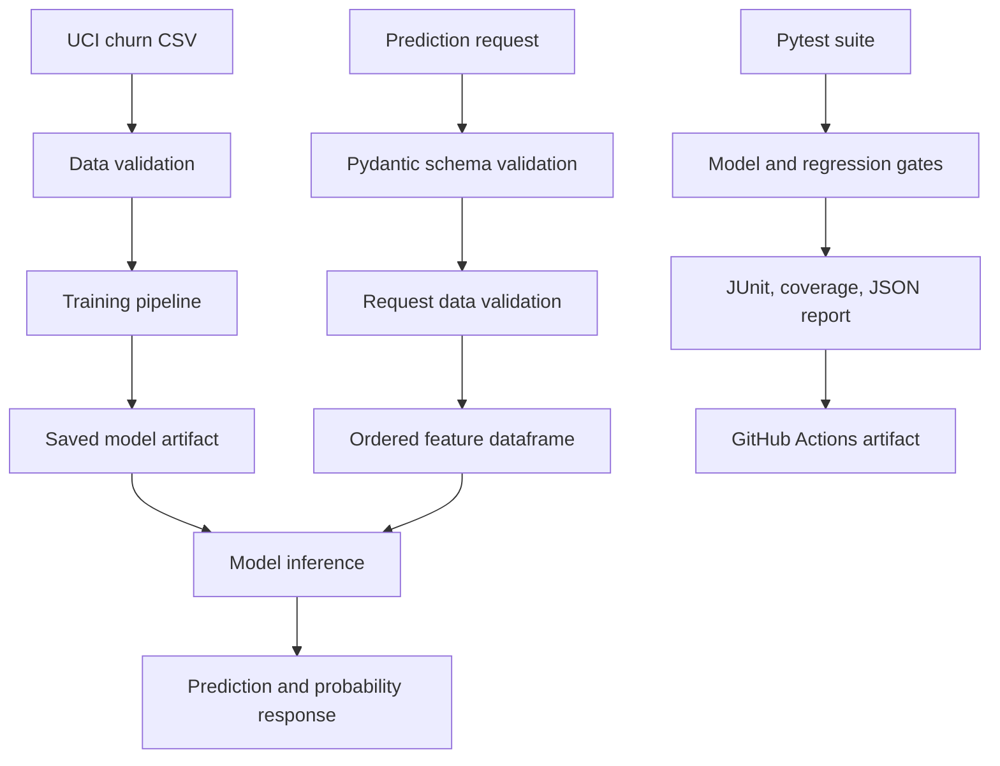
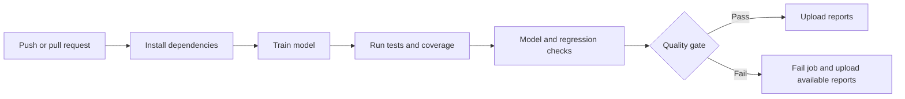

# AI/ML Quality Assurance & Automated Testing Framework

A small QA project that checks a customer churn prediction service across data validation, model behavior, API responses, regression rules, and CI. The focus is the testing framework; Logistic Regression is a simple example model.

## Table of Contents

1. [Overview](#1-overview)
2. [Key Features](#2-key-features)
3. [Technology Stack](#3-technology-stack)
4. [Getting Started](#4-getting-started)
5. [Usage](#5-usage)
6. [Project Structure](#6-project-structure)
7. [Architecture and Workflow](#7-architecture-and-workflow)
8. [Results and Evaluation](#8-results-and-evaluation)
9. [Limitations](#9-limitations)
10. [Future Improvements](#10-future-improvements)

## 1. Overview

### Problem

Traditional application tests do not cover every failure mode introduced by machine learning systems. Input data can have missing fields or unexpected values; preprocessing can become incompatible with a model; predictions can have the wrong format; and a replacement model can perform worse than its baseline.

### Purpose

This project demonstrates how a QA engineer can add checks around a small ML prediction service. It is designed as a fresher-level portfolio project that can be explained component by component. It does not attempt to build a production churn model or a general-purpose MLOps platform.

### Example system

The example predicts one of two classes:

| Value | Meaning |
| --- | --- |
| `0` | Customer likely to stay |
| `1` | Customer likely to churn |

The project uses the Iranian Churn dataset from the [UCI Machine Learning Repository](https://archive.ics.uci.edu/dataset/563/iranian+churn+dataset). It contains 3,150 customer rows, 13 numeric input fields, and a binary churn label. UCI describes records collected over 12 months, with features aggregated from the first nine months and churn recorded at month 12.

The dataset is licensed under [CC BY 4.0](https://creativecommons.org/licenses/by/4.0/). Attribution: *Iranian Churn [Dataset]. (2020). UCI Machine Learning Repository. https://doi.org/10.24432/C5JW3Z.* The CSV is saved as `data/raw/Customer Churn.csv`; see [`data/README.md`](data/README.md) for source details.

## 2. Key Features

- A public churn dataset with source attribution and reproducible stratified evaluation.
- FastAPI endpoints for health, model information, and prediction.
- Pydantic request validation and reusable dataframe quality checks.
- Unit, data, API, model, regression, and integration tests organized by test layer.
- Model checks for feature compatibility, loadability, output shape, probability range, and minimum F1.
- Regression checks for accuracy, precision, recall, F1, and ROC-AUC, with an F1 tolerance gate.
- Pytest coverage output, JUnit XML, and a JSON report based on measured runs.
- GitHub Actions workflow for pull requests and pushes, with report artifacts.

## 3. Technology Stack

| Area | Technology |
| --- | --- |
| Language | Python (tested locally with Python 3.13.10; CI uses Python 3.12) |
| Data | Pandas, NumPy |
| Machine learning | scikit-learn, Logistic Regression |
| Model persistence | Joblib |
| API | FastAPI, Pydantic, Uvicorn |
| Tests and coverage | Pytest, pytest-cov, HTTPX (FastAPI test client dependency) |
| Automation | GitHub Actions |

The installed dependency versions are resolved from the ranges in `requirements.txt`. This project currently has no lock file.

## 4. Getting Started

### Requirements

- Python 3.10 or newer. Python 3.12 is used by CI.
- `pip` and a network connection for the first dependency installation.
- The supplied UCI CSV at `data/raw/Customer Churn.csv`; no API key, cloud account, GPU, or special hardware is needed.

### Create an environment and install dependencies

From the repository root:

```bash
python3 -m venv .venv
source .venv/bin/activate
python -m pip install --upgrade pip
python -m pip install -r requirements.txt
```

On Windows PowerShell, activate with:

```powershell
.venv\Scripts\Activate.ps1
```

### Train the model

```bash
python -m training.train
```

This creates `models/churn_model.joblib`. The model artifact is generated locally and ignored by Git. Training uses the supplied CSV and a fixed scikit-learn random state.

### Start the API

```bash
uvicorn app.main:app --reload
```

The local API is available at `http://127.0.0.1:8000`. Interactive OpenAPI documentation is at `http://127.0.0.1:8000/docs`.

<!-- Screenshot placeholder: replace this comment with a screenshot of /docs and a successful /predict request. -->

## 5. Usage

### Endpoints

| Method | Path | Purpose |
| --- | --- | --- |
| `GET` | `/health` | Confirms the model artifact can be loaded; returns HTTP 503 when unavailable. |
| `GET` | `/model-info` | Returns the demo model name, version, and type. |
| `POST` | `/predict` | Validates one customer record and returns a class and churn probability. |

Example prediction request:

```json
{
  "call_failure": 8,
  "complains": 0,
  "subscription_length": 38,
  "charge_amount": 0,
  "seconds_of_use": 4370,
  "frequency_of_use": 71,
  "frequency_of_sms": 5,
  "distinct_called_numbers": 17,
  "age_group": 3,
  "tariff_plan": 1,
  "status": 1,
  "age": 30,
  "customer_value": 197.64
}
```

Example response shape (the actual numeric values are produced by the trained model):

```json
{
  "prediction": 1,
  "label": "churn",
  "churn_probability": 0.72
}
```

Invalid fields and out-of-range values are rejected with HTTP 422. Prediction probabilities come from the locally trained model artifact.

### Run the test suite

```bash
python -m pytest
```

The configured command reports terminal coverage and writes `reports/coverage.xml`. To create the complete test, coverage, model, and regression summary:

```bash
python scripts/generate_report.py
```

The report command expects the model to exist; train it first. It writes `reports/junit.xml`, `reports/coverage.xml`, and `reports/test_report.json`. These run artifacts are ignored by Git except for the checked-in baseline file.

### Configuration

| Environment variable | Default | Meaning |
| --- | --- | --- |
| `MINIMUM_F1` | `0.60` | Minimum F1 required by model validation and regression acceptance. Must be between 0 and 1. |
| `MAX_F1_DROP` | `0.02` | Largest F1 decrease allowed relative to the saved regression baseline. Must be between 0 and 1. |

For example, set a different model floor before running the report (a threshold above observed holdout F1 will fail):

```bash
MINIMUM_F1=0.75 MAX_F1_DROP=0.01 python scripts/generate_report.py
```

### Troubleshooting

- **Model unavailable:** run `python -m training.train` from the repository root, then restart Uvicorn.
- **Missing package:** activate `.venv` and run `python -m pip install -r requirements.txt`.
- **`python` command not found:** use `python3` to create the environment, then use `python` after activation.
- **Quality gate fails on F1:** inspect `reports/test_report.json`; confirm the configured threshold is suitable for this demo and avoid lowering it just to hide a regression.
- **Regression baseline missing or invalid:** ensure `reports/baseline_metrics.json` exists. It is checked in and contains metrics for the deterministic holdout workflow.
- **Port 8000 already in use:** start the service on another port, for example `uvicorn app.main:app --reload --port 8001`.

## 6. Project Structure

```text
.
├── .github/workflows/tests.yml     # Push and pull request quality gate
├── app/
│   ├── main.py                     # FastAPI routes and inference orchestration
│   ├── model.py                    # Cached model loading
│   ├── preprocessing.py            # Feature order and dataframe conversion
│   └── schemas.py                  # Pydantic request and response contracts
├── data/
│   └── raw/Customer Churn.csv      # UCI Iranian Churn dataset (CC BY 4.0)
├── models/                         # Generated model artifact (ignored by Git)
├── reports/
│   ├── baseline_metrics.json       # Checked-in regression baseline
│   └── ...                         # Generated reports (mostly ignored by Git)
├── scripts/
│   └── generate_report.py          # Test, coverage, model, and regression summary
├── tests/
│   ├── api/                        # HTTP endpoint behavior
│   ├── data/                       # Data validation rules
│   ├── integration/                # End-to-end pipeline and negative cases
│   ├── model/                      # Model loading, output, and performance
│   ├── regression/                 # Baseline comparison behavior
│   └── unit/                       # Preprocessing and deterministic data helpers
├── training/
│   └── train.py                    # CSV loading, validation, and model training
├── validation/
│   ├── data_validation.py          # Reusable schema and value checks
│   ├── model_validation.py         # Model artifact and minimum-F1 checks
│   └── regression_validation.py    # Metrics and baseline acceptance gate
├── requirements.txt
└── pytest.ini
```

## 7. Architecture and Workflow

### Component architecture



### Prediction workflow

1. `training/train.py` reads the supplied CSV, checks required columns and values, then fits a scikit-learn pipeline.
2. The fitted pipeline is saved under `models/` with Joblib.
3. FastAPI validates the JSON fields and permitted ranges with Pydantic.
4. `build_features` orders the 13 fields as expected by the model.
5. `validate_customer_data` checks the dataframe schema, nulls, duplicates, and numeric ranges. The source CSV has repeated feature profiles but no customer ID, so repeated profiles are allowed when loading it.
6. The model returns the class and class probabilities; the API maps these to a JSON response.

### Quality workflow

1. Pytest runs the unit, data, API, model, regression, and integration test groups.
2. pytest-cov measures coverage for `app`, `training`, and `validation`.
3. The model gate checks expected feature names, output values, probability ranges, and F1 on a deterministic holdout evaluation.
4. The regression gate evaluates a candidate on the same holdout and compares F1 with `reports/baseline_metrics.json`. Other metrics are reported for context; only F1 drives the regression pass/fail decision.
5. `scripts/generate_report.py` records actual test counts, coverage, model checks, comparison metrics, and overall quality-gate status.
6. GitHub Actions runs these steps on pushes and pull requests. A failing test or model/regression gate fails the job.

### CI workflow diagram



<!-- Screenshot placeholder: replace this comment with a screenshot of a completed GitHub Actions run and its report artifacts. -->

## 8. Results and Evaluation

### Current measured run

Run `python scripts/generate_report.py` for current measured values. The values below should be refreshed after model or test changes.

| Measure | Observed result |
| --- | ---: |
| Tests | 44 passed, 0 failed, 0 skipped |
| Line coverage for `app`, `training`, `validation` | 88.80% |
| Holdout baseline F1 | 0.618 |
| Candidate holdout F1 | 0.618 |
| Candidate accuracy | 0.832 |
| Candidate precision | 0.482 |
| Candidate recall | 0.863 |
| Candidate ROC-AUC | 0.922 |
| Quality gate | PASSED |

The values above come from the measured run on 2026-10-10 and the checked-in `reports/baseline_metrics.json`. Pytest currently emits one Starlette deprecation warning through FastAPI's test client; it does not fail the suite.

<!-- Screenshot placeholder: replace this comment with a screenshot of the generated test report summary. -->

### Evaluation methodology

- UCI provides 3,150 rows with 13 numeric input fields and a binary `Churn` target. The loader normalizes source column names for the API and model.
- Candidate evaluation uses a stratified 75/25 train/holdout split with a fixed split seed.
- A fresh Logistic Regression pipeline is fitted on the training portion and scored on the holdout portion for baseline and regression metrics.
- F1 must meet `MINIMUM_F1` (currently `0.60`) and must not drop below the baseline by more than `MAX_F1_DROP` (`0.02`). The floor is a demo gate chosen below the measured F1; it is not a domain-approved business threshold.
- Accuracy, precision, recall, and ROC-AUC are calculated and reported. They do not independently block the gate.
- Coverage is measured for application, training, and validation source code, not tests or scripts.

This is a reproducible demonstration on a historical public dataset, not evidence of performance on current customer populations or a business outcome.

## 9. Limitations

- The dataset is historical and comes from one Iranian telecom company; it may not represent other regions, providers, or current customer behavior.
- The dataset has no customer identifier and includes repeated feature profiles. These could be distinct customers with matching values, so the loader does not treat repeated profiles as duplicate customers.
- The model is a teaching example, not a production model. There is no claim that it is useful for current real-world churn prediction.
- The baseline is a checked-in metric file for a deterministic holdout workflow. It demonstrates comparison logic, but does not provide model registry, version lineage, or a historical experiment store.
- In this starter, the report candidate is retrained from the same fixed code and split as the baseline. The regression tests prove that degradation is rejected using a deliberately weak fake model; separate candidate model versions are a future improvement.
- The split and model are fixed. This does not test robustness across time, geographic groups, changing populations, or repeated random seeds.
- API tests use FastAPI's in-process test client. The CI workflow does not start a deployed server or test network, container, or cloud behavior.
- There is no authentication, database, monitoring, drift alerting, deployment, or data privacy pipeline.
- The generated Joblib file is not checked in. A compatible environment must train the artifact before running the service or report command.
- Dependency ranges are used without a lock file; installed patch versions can change over time.
- No `LICENSE` file is included, so the repository does not currently declare reuse terms.

## 10. Future Improvements

- Add a pinned dependency lock file and verify supported Python versions in CI.
- Add checks for target balance and unexpected changes in the supplied CSV.
- Compare separately versioned model artifacts and store baseline metadata, training split identifiers, and model versions together.
- Add tests for feature mismatch and non-finite probabilities using controlled fake models.
- Add an explicit CI coverage threshold if the project adopts a justified minimum.
- Add linting and static checks once the formatting and lint rules are selected.
- Add container-based API startup tests if deployment behavior becomes part of the project scope.
- Add group-wise or time-based evaluation if suitable attributes become available.
- Replace the documented screenshot comments with genuine screenshots after capturing them from the local API and GitHub Actions run.

---
